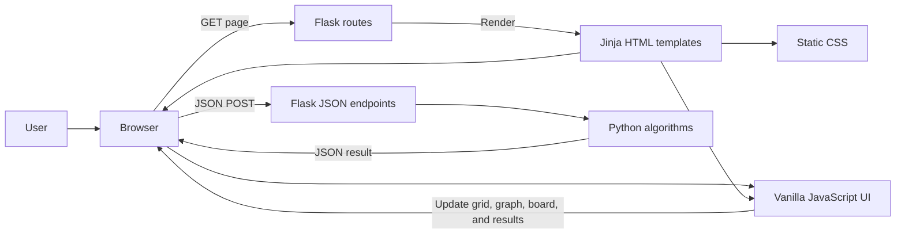
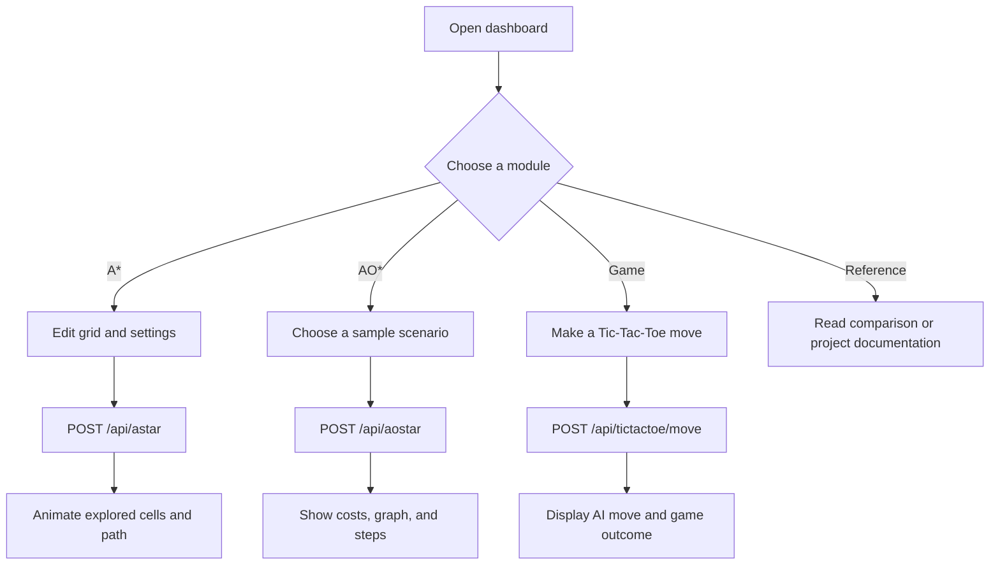

# Smart Game Strategy and Decision-Making System

> **SmartGame AI** is an educational web application for exploring heuristic search, AND-OR problem decomposition, and game-tree decision-making.
>
> **Logo:** No image logo is included in the repository. The application uses a text-and-symbol brand mark.


There is no declared release version, license file, build pipeline, or CI status in the repository; badges for those are intentionally omitted.

## Table of contents

- [Project overview](#project-overview)
- [Problem, vision, and objectives](#problem-vision-and-objectives)
- [Features, users, use cases, and value](#features-users-use-cases-and-value)
- [Screenshots](#screenshots)
- [Architecture and workflows](#architecture-and-workflows)
- [Technology stack](#technology-stack)
- [Repository structure](#repository-structure)
- [Application modules](#application-modules)
- [Backend, APIs, and data](#backend-apis-and-data)
- [Security, privacy, and limitations](#security-privacy-and-limitations)
- [Prerequisites and installation](#prerequisites-and-installation)
- [Configuration and environment variables](#configuration-and-environment-variables)
- [Run locally](#run-locally)
- [Production deployment](#production-deployment)
- [Build, CI/CD, and release](#build-cicd-and-release)
- [Testing and debugging](#testing-and-debugging)
- [Coding and contribution guidelines](#coding-and-contribution-guidelines)
- [Roadmap](#roadmap)
- [FAQ and troubleshooting](#faq-and-troubleshooting)
- [Changelog](#changelog)
- [License, credits, and contact](#license-credits-and-contact)
- [Project summary](#project-summary)

## Project overview

Smart Game Strategy is a browser-based learning project that demonstrates three AI techniques through interactive examples:

1. **A\*** finds a low-cost path across a grid using a priority queue and a distance heuristic.
2. **AO\*** illustrates cost evaluation over sample AND-OR problem graphs.
3. **Minimax with alpha-beta pruning** selects Tic-Tac-Toe moves for a computer opponent.

The web application combines a Python/Flask server with HTML templates, CSS, and vanilla JavaScript. Users can inspect the search process and results rather than interacting with a command-line implementation.

This repository is an educational prototype, not a production decision-support service. Its examples are small and in-memory; it does not provide accounts, persistence, or a separately deployed frontend.

## Problem, vision, and objectives

### Problem statement

Search and decision algorithms can be difficult to understand when their state changes and choices are hidden. The project makes selected algorithm behavior observable through grids, graphs, step lists, scores, and comparisons.

### Vision

Provide a compact, approachable environment for learning how heuristic search, problem decomposition, and adversarial game search differ.

### Objectives

- Demonstrate A* with editable grid obstacles and Manhattan or Euclidean heuristics.
- Present sample AND-OR scenarios and their computed costs.
- Let a user play Tic-Tac-Toe against an AI with selectable difficulty behavior.
- Explain and compare the algorithms in one navigable web application.
- Keep the implementation simple enough to inspect and extend in a coursework or learning context.

## Features, users, use cases, and value

### Implemented features

| Module | What a user can do |
|---|---|
| Dashboard | Navigate the application and read concise project and algorithm summaries. |
| A* pathfinding | Set start/end cells, place or erase walls, select a heuristic and grid size, generate a random maze, and watch exploration and path results. |
| AO* scenarios | Choose one of four built-in scenarios, run the cost calculation, inspect the graph and steps, or advance through displayed steps. |
| Tic-Tac-Toe | Play as X or O, choose Easy/Medium/Hard, restart, and view move-score information. |
| Comparison | Read a side-by-side conceptual comparison of A* and AO*. |
| Project documentation | Read the in-app academic overview and algorithm explanations. |

### Target users and use cases

- **Students and instructors:** demonstrate heuristic search and game-tree concepts.
- **Developers learning AI:** compare pathfinding with AND-OR evaluation and adversarial search.
- **Project evaluators:** explore the implemented examples through a browser.

Typical use cases include observing how obstacles affect a route, comparing heuristic choices, inspecting alternative problem decompositions, and playing a small game against an AI opponent.

### Business value

The project provides an interactive teaching aid and a starting point for experimentation. It does not currently have commercial workflows, user analytics, or business-service integrations.

## Screenshots

No screenshots are checked into the repository. Capture the dashboard, A* grid, AO* graph, and game arena after starting the application if screenshots are needed for a presentation or project page.

## Architecture and workflows

### High-level architecture



The browser owns the interactive presentation and transient UI state. Flask serves the pages and executes the algorithms requested through JSON endpoints. There is no database or separate service layer.

### Application workflow

1. Flask serves a page using a template from `templates/`.
2. The page loads shared styling and the JavaScript for that module.
3. The user changes the module's in-memory browser state and starts an operation.
4. The module sends a JSON `POST` request to the corresponding Flask endpoint.
5. Python computes the result and returns JSON.
6. JavaScript renders the response and, where applicable, animates it.

### End-to-end user flow



## Technology stack

| Layer | Technology | Role |
|---|---|---|
| Server | Python 3, Flask | Page rendering and JSON API endpoints. |
| Templates | HTML and Jinja | Server-rendered page shells and static asset URLs. |
| Browser logic | Vanilla JavaScript | Module state, API calls, visualizations, and animation. |
| Styling | CSS | Shared responsive layout, controls, and visual design. |
| Graph visualization | HTML Canvas | Draws the AO* scenario graph. |
| Dependencies | `Flask>=2.3.0` | The only declared Python dependency. |

No frontend framework, bundler, database, authentication provider, AI model service, or external application API is configured. Google Fonts are referenced by the HTML pages and therefore require an internet connection for those font assets; the app itself does not otherwise require a third-party runtime service.

## Repository structure

```text
.
├── app.py
├── requirements.txt
├── README.md
├── templates/
│   ├── index.html
│   ├── astar.html
│   ├── aostar.html
│   ├── game.html
│   ├── comparison.html
│   └── documentation.html
└── static/
    ├── css/
    │   └── style.css
    └── js/
        ├── main.js
        ├── astar.js
        ├── aostar.js
        └── game.js
```

### Folder responsibilities

- **`templates/`** — Flask-rendered HTML pages. Each page links to shared CSS and the JavaScript it needs.
- **`static/css/`** — Application-wide presentation and responsive styles.
- **`static/js/`** — Browser-side navigation helpers and per-module interaction logic.
- **Repository root** — Flask entry point, Python dependency list, and this project guide.

## Application modules

### Dashboard — `templates/index.html`

The landing page introduces the project and links to the four interactive/reference areas. It includes summary cards for A*, AO*, Tic-Tac-Toe, comparison, and the in-app documentation.

### A* pathfinding — `templates/astar.html`, `static/js/astar.js`

The browser creates a default 15-by-20 grid with start and goal cells. The user can set endpoints, draw/erase obstacles, choose among 10, 15, and 20 row sizes, select Manhattan or Euclidean distance, set animation speed, reset the grid, or generate a random maze. The server uses four-directional movement with a unit step cost. The UI displays explored cells, a returned path, cost, number of explored nodes, and `g`, `h`, and `f` values.

The heuristic choice is a demonstration control. As implemented, Manhattan distance is suitable for the four-directional unit-cost grid; Euclidean distance is also available for comparison.

### AO* examples — `templates/aostar.html`, `static/js/aostar.js`

The UI contains four pre-defined example graphs: travel planning, robot assembly, game strategy, and medical diagnosis. It draws nodes and edges on a canvas and displays the server's computed steps and final cost. The graph data is defined in the JavaScript client and sent to the server; arbitrary graph editing is not provided by the UI.

The current Python routine recursively evaluates the supplied graph and edge groups. It is an educational cost-evaluation example, not a general-purpose AO* engine with graph expansion, cycle handling, or validation. See [Known limitations](#known-limitations).

### Tic-Tac-Toe — `templates/game.html`, `static/js/game.js`

The browser manages the board, score display, and turn flow. The Flask endpoint returns the AI move and move scores. Hard uses full minimax with alpha-beta pruning; Easy and Medium sometimes select a random legal move before falling back to minimax. The displayed difficulty depth is informational UI; the server does not enforce a depth limit.

### Comparison — `templates/comparison.html`

Static educational content comparing A* and AO* terminology, intended problem shapes, and conceptual properties. This page is explanatory material, not a benchmark runner.

### In-app documentation — `templates/documentation.html`

An academic-style project report covering the motivation, methodology, algorithms, applications, and future scope. This complements the repository setup and architecture guidance in this README.

### Shared frontend — `static/js/main.js`, `static/css/style.css`

`main.js` handles the mobile navigation toggle, navbar scroll styling, animated dashboard counters/cards, speed display, toast notifications, and a small asynchronous delay helper. `style.css` provides the shared visual system and responsive layouts.

## Backend, APIs, and data

### Flask pages

| Method | Path | Purpose |
|---|---|---|
| `GET` | `/` | Dashboard. |
| `GET` | `/astar` | A* grid visualization. |
| `GET` | `/aostar` | AO* scenario visualization. |
| `GET` | `/game` | Tic-Tac-Toe game. |
| `GET` | `/comparison` | A* and AO* comparison. |
| `GET` | `/documentation` | In-app project report. |

### JSON endpoints

All API routes currently accept JSON `POST` requests. There is no API version prefix, formal schema validation, or authentication.

| Method and path | Request fields | Response summary |
|---|---|---|
| `POST /api/astar` | `grid`: 2D array (`0` walkable, `1` blocked); `start` and `goal`: `[row, column]`; optional `heuristic`: `manhattan` or `euclidean` (defaults to Manhattan). | `success`, `path`, `explored`, `path_cost`, `nodes_explored`, per-node `steps`, and `execution_time`; on failure also includes a message. |
| `POST /api/aostar` | `start`; `nodes` containing `name`, `type`, and `heuristic`; `edges` containing `from`, `to` (child-name array), `type` (`AND` or `OR`), and optional `cost`. | `success`, evaluation `steps`, `final_cost`, `solved_nodes`, node summaries, and `execution_time`. |
| `POST /api/tictactoe/move` | `board`: nine entries (`''`, `X`, or `O`); optional `ai_player`, `human_player`, and `difficulty` (`easy`, `medium`, `hard`). | AI `move`, updated `board`, `winner`, `winning_line`, `move_analysis`, and `ai_player`. A terminal submitted board returns its winner and move `-1`. |
| `POST /api/generate_maze` | Optional `rows`, `cols`, and `density` (defaults: 15, 20, and 0.3). | Random `grid`, `rows`, and `cols`; start and goal corners are cleared. |

The endpoints are designed for the bundled UI and trusted local experimentation. Request bodies are not comprehensively validated; malformed or out-of-range values may result in server errors. Do not treat them as hardened public APIs.

### Algorithm behavior

- **A\*:** Uses `f(n) = g(n) + h(n)`, a Python min-heap, unit-cost four-way neighbors, and the selected distance heuristic. It returns explored nodes and per-node scores for visualization.
- **AO\* example:** Recursively evaluates child groups from the provided graph, adds child and edge costs, and chooses the least-cost group. The edge group's type controls the selection branch; the node's type is currently descriptive, and every child in an edge group contributes to its summed cost. This simplified implementation does not expand an implicit search graph.
- **Tic-Tac-Toe:** Minimax scores terminal states relative to search depth and applies alpha/beta cutoffs. Easy randomly chooses a legal move 70% of the time and Medium does so 30% of the time; otherwise both use minimax, as does Hard.

### Database, storage, state, and integrations

- **Database:** None. No user or application data is stored in a database.
- **Storage:** The server computes from request data in memory. Browser game scores and current UI state are JavaScript variables and are lost on page reload. No file or cloud storage is configured.
- **State management:** Local variables in each module script; there is no shared state library or persistence layer.
- **Authentication and authorization:** None. All pages and endpoints are unauthenticated.
- **Third-party integrations:** No backend service integration is present. HTML pages load Google Fonts from Google's font CDN.
- **AI/automation services:** No LLM, external model, or autonomous agent is used. The AI behaviors are deterministic algorithm implementations except for random choices and maze generation.

## Security, privacy, and limitations

### Security considerations

- The project has no login, authorization, CSRF protection, rate limiting, or API input validation. Keep it on a trusted development machine or place it behind an appropriately configured production boundary.
- The `python app.py` development entry point binds to `0.0.0.0` and enables Flask debug mode. Do not use that mode on an untrusted or public network.
- The API accepts caller-provided grids and graphs without comprehensive size, shape, or cycle checks. Restrict access and inputs if adapting it for a shared service.
- Do not submit sensitive information; the application is not designed to handle or store it.
- Font requests to Google disclose normal connection metadata to that third party when fonts are fetched.

### Known limitations

- No automated tests, test configuration, CI workflow, container, or deployment manifest is included.
- The AO* routine is a recursive educational evaluator. It does not implement iterative graph expansion or cycle detection, and malformed/cyclic graph inputs are not handled safely.
- The game interface displays depth and pruning-related fields, but the backend does not expose a configurable depth limit or count pruned states. Easy/Medium are randomized move policies, not shallower searches.
- API inputs are not validated; grid dimensions, coordinates, board values, graph references, and maze parameters should be considered trusted input.
- There is no persistence, user management, monitoring, or production logging configuration.
- No version, license, maintainer contact, or release policy is declared in the repository.

## Prerequisites and installation

### Prerequisites

- Python 3.8 or newer is recommended.
- `pip` (included with standard Python installations).
- A modern browser with JavaScript enabled.
- Internet access is optional for application logic; it is needed to retrieve the Google Fonts used by the pages.

### Install dependencies

From the repository root, create and activate a virtual environment, then install the single declared dependency.

**Windows PowerShell**

```powershell
py -m venv .venv
.\.venv\Scripts\Activate.ps1
python -m pip install --upgrade pip
python -m pip install -r requirements.txt
```

**macOS / Linux**

```bash
python3 -m venv .venv
source .venv/bin/activate
python -m pip install --upgrade pip
python -m pip install -r requirements.txt
```

If PowerShell prevents virtual-environment activation due to its execution policy, use an approved local policy or invoke the environment's Python directly as `.venv\Scripts\python.exe`.

## Configuration and environment variables

There is currently no `.env` file, environment-variable configuration, or settings module. The app uses Flask defaults and hard-coded local server settings in the `__main__` block. No secret key is configured because the app does not currently use sessions or signed cookies.

For production, configure the WSGI server, network binding, logging, and any secrets through the deployment platform rather than committing secrets to the repository.

## Run locally

With the virtual environment active and dependencies installed:

```powershell
python app.py
```

Open [http://127.0.0.1:5000](http://127.0.0.1:5000). The `app.py` entry point prints the local URL and starts Flask on port 5000. It currently enables debug mode and binds to all interfaces, so use it only for local development.

To stop the server, press `Ctrl+C` in the terminal.

## Production deployment

The repository does not include a production WSGI server dependency or a production deployment configuration. For deployment, use a supported WSGI server for the target platform (for example, Waitress on Windows or Gunicorn on Linux), install it as part of the deployment environment, and serve the imported Flask `app` object. Configure the server to bind only to the intended interface and disable debug mode. Put a reverse proxy or platform ingress in front if appropriate.

The Flask development server (`python app.py` or `flask run`) is not a production server. Before exposing this project to untrusted users, add request validation and resource limits, review the security considerations above, and configure production logging and monitoring.

### Build process

There is no frontend build step or asset compilation. Flask serves the HTML templates and static files directly from `templates/` and `static/`.

### CI/CD overview

No CI/CD workflow is present. Builds, automated checks, release publishing, and deployment are not configured in this repository.

## Testing and debugging

### Testing strategy

No automated test suite is included. For a basic manual smoke test:

1. Start the server and open the dashboard.
2. Run A* on the default grid and then with a wall or generated maze.
3. Run each AO* scenario and inspect the reported cost and steps.
4. Play a game with both player symbols and try each difficulty.
5. Open the comparison and documentation pages.
6. Check browser developer tools and the Flask terminal for errors.

When adding automated tests, prioritize direct tests for algorithm inputs and edge cases, API response shapes, and the browser flows that depend on those shapes.

### Debugging tips

- **Page not found:** verify the server is running and use the exact routes listed above.
- **Missing Python module:** activate the project virtual environment and run `python -m pip install -r requirements.txt`.
- **API or visualization error:** inspect the browser Network panel for the JSON request/response and check the Flask terminal traceback.
- **Styles or scripts appear stale:** refresh the page and confirm the requested static file path in the browser Network panel.
- **Google Fonts do not load:** the app can still run; check network access or use browser developer tools to identify blocked font requests.

### Logging and monitoring

The app has no configured application logger, monitoring, or telemetry. Flask's development server writes request and error information to the terminal. Production operators must configure appropriate logging, retention, alerting, and health checks for their hosting environment.

## Coding and contribution guidelines

### Conventions

- Keep backend routes and algorithm implementations in `app.py` unless the project is deliberately refactored into modules.
- Keep page markup in `templates/`, shared styles in `static/css/style.css`, and browser behavior in the matching `static/js/` module.
- Preserve the existing lightweight Flask and vanilla JavaScript approach unless a new dependency is justified.
- Keep API request and response shapes synchronized with their JavaScript callers.
- Add validation when accepting new externally supplied data; current endpoints do not establish a general validation pattern.
- Document behavior changes and provide manual or automated verification steps with contributions.

### Contribution workflow

1. Fork or branch from the default branch.
2. Make a focused change and avoid unrelated formatting or generated files.
3. Install dependencies and run the application through the affected flow.
4. Include tests when adding test infrastructure or changing algorithm behavior.
5. Open a pull request describing the change, rationale, and verification performed.

There is no `CONTRIBUTING.md`, required branch naming convention, pull-request template, or configured review policy at present.

### Versioning and releases

No versioning scheme or release process is declared. If releases are introduced, use tagged versions and maintain a changelog describing user-visible changes. No release automation is currently configured.

## Roadmap

The following are potential improvements, not committed releases:

- Add automated unit and API tests.
- Validate and bound all API request payloads.
- Improve the AO* implementation with explicit graph validation, cycle handling, and algorithmically accurate expansion/propagation.
- Make game difficulty and displayed analysis metrics correspond to backend behavior.
- Add production deployment configuration and operational documentation.
- Add screenshots, license metadata, and contributor/release policies.

## FAQ and troubleshooting

**Does this application need a database?**  
No. Current examples use in-memory state and request payloads.

**Can I create my own AO* graph in the interface?**  
No. The UI currently offers four scenarios defined in `static/js/aostar.js`. The API accepts graph data but is not validated for arbitrary or untrusted graphs.

**Are game scores saved?**  
No. The scoreboard exists only in browser memory and resets when the page is reloaded.

**Why does the AI's displayed search depth not change its strength?**  
The depth value is a UI display. The backend performs minimax to terminal states for non-random moves; Easy and Medium instead sometimes choose a random legal move.

**Can I deploy this directly to a public server?**  
The repository has no production setup, authentication, or comprehensive validation. Do not expose the development server publicly. Add appropriate production infrastructure and security controls before deployment.

**What license applies?**  
No license is included. See [License, credits, and contact](#license-credits-and-contact); do not assume the project is open source or reuse it under an unstated license.

## Changelog

No changelog or tagged release history is included in the project files. Use this format if one is introduced:

```text
## [Unreleased]
### Added
### Changed
### Fixed
### Security
```

## License, credits, and contact

### License

No `LICENSE` file or license declaration is present in the repository. The usage and redistribution terms are therefore unspecified. Add an explicit license before inviting reuse or distribution.

### Credits and acknowledgements

The project presents established AI concepts including A*, AO*, minimax, and alpha-beta pruning. The repository does not identify individual authors, external code sources, or additional acknowledgements.

### Contact

No maintainer contact address or support channel is declared in the project files. Use the repository hosting project's issue or discussion facilities if they are enabled by its owner.

## Project summary

Smart Game Strategy is a lightweight Flask learning application that lets users explore grid pathfinding, sample AND-OR graph cost evaluation, and Tic-Tac-Toe decision-making. It is straightforward to run locally and inspect, but remains an educational prototype: it has no persistence, automated tests, production configuration, authentication, or declared license.
